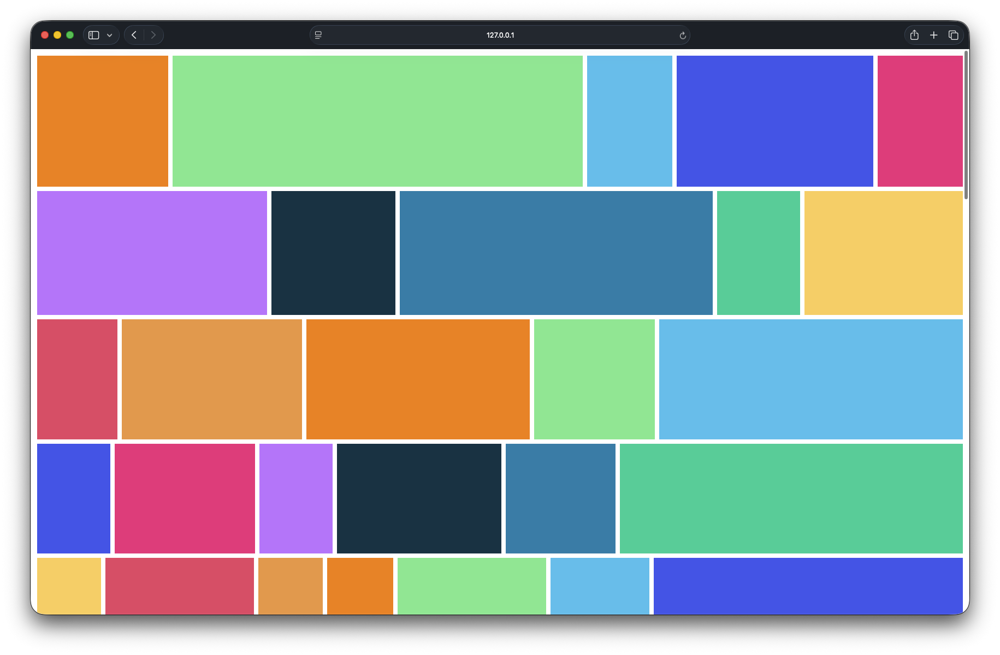

# Saladbooru

A minimal, file-only booru variant: drop images into a folder and they appear in the gallery.
No database, URL import, tags, or generated thumbnails to maintain.
JPEG, PNG, GIF, WebP, and AVIF are supported; HEIC/HEIF are not.
The gallery is readable without login; only uploads require a bearer token.



## Getting Started

`base/` is a portable Kustomize Deployment, Service, and PVC.
Before `kubectl apply -k base`, replace `saladbooru:latest` with an image your cluster can pull and provide writable storage for UID 10001.
Create Secret `saladbooru-credentials` with a 32+-character `SALADBOORU_TOKEN` key in the same namespace.
Post a file with `POST /api/posts` as multipart `file` with `Authorization: Bearer <token>`; placing it in `/data/images/` works without an API.

### Try it locally

Run with Docker Compose:

```sh
docker compose -f docker-compose.dev.yml up --build -d
```

Open http://127.0.0.1:18080/ and put images directly in `data/images/`.
`src/app.ts` compiles to ignored `static/app.js` for Go's embedded UI.
Run `npm ci && npm run check && npm run build`, then `go test ./...`; the Dockerfile runs the UI checks and build automatically.

## License

[MIT](LICENSE)
